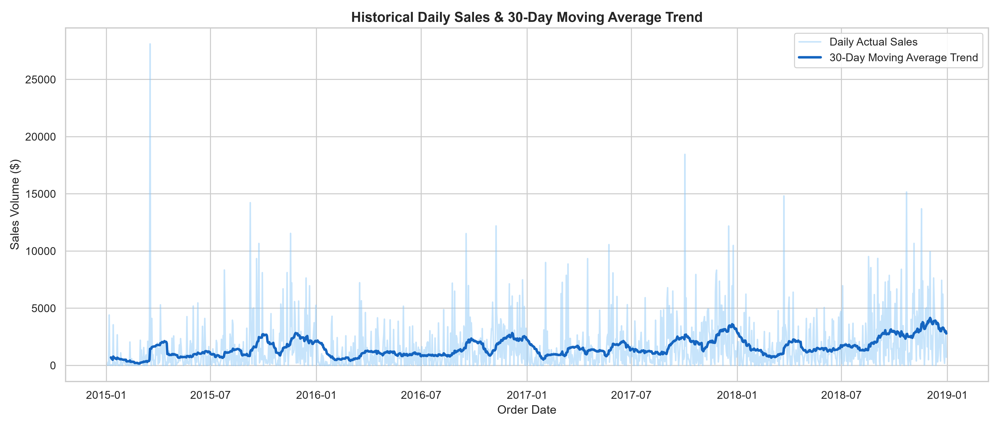
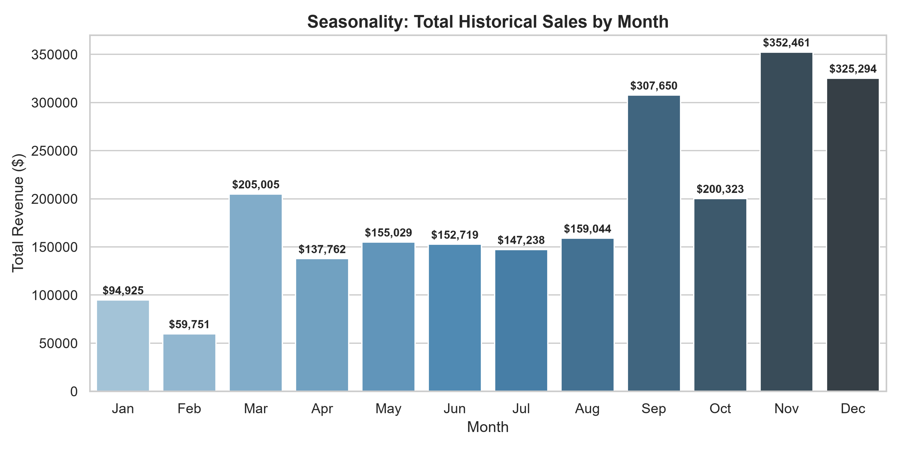
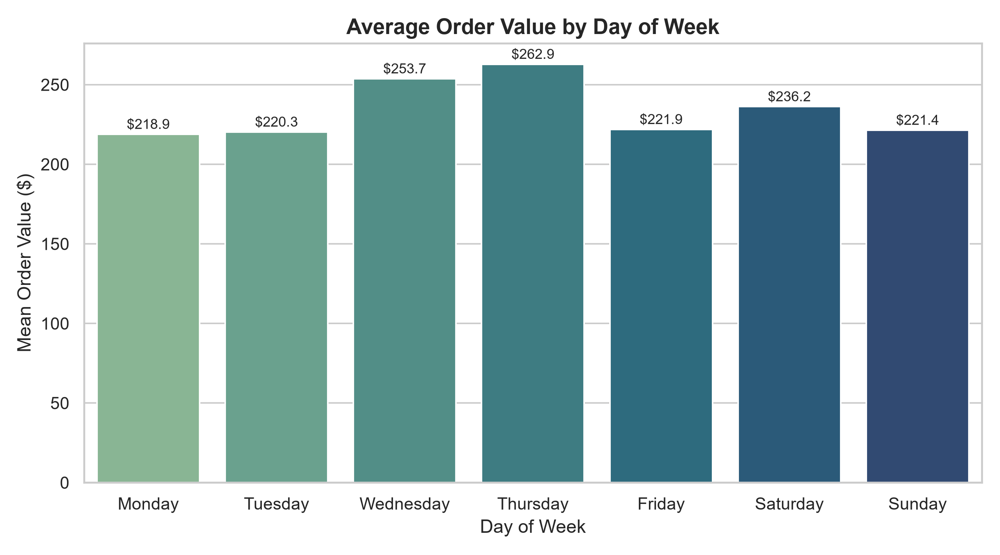
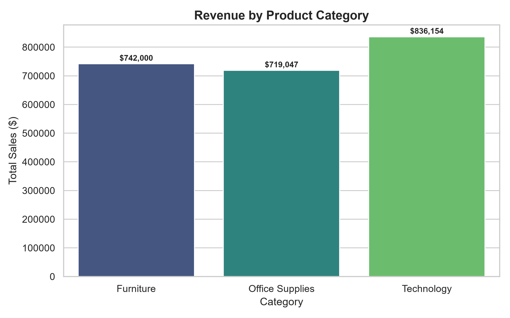
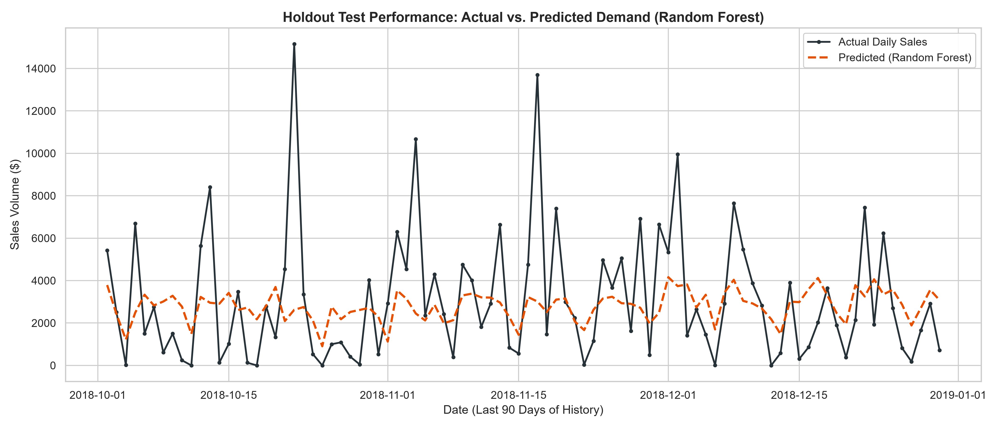
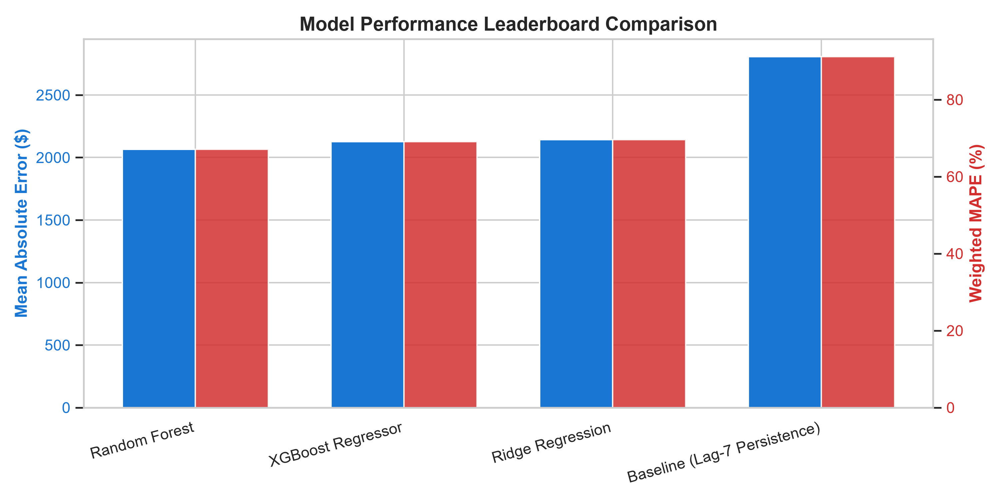
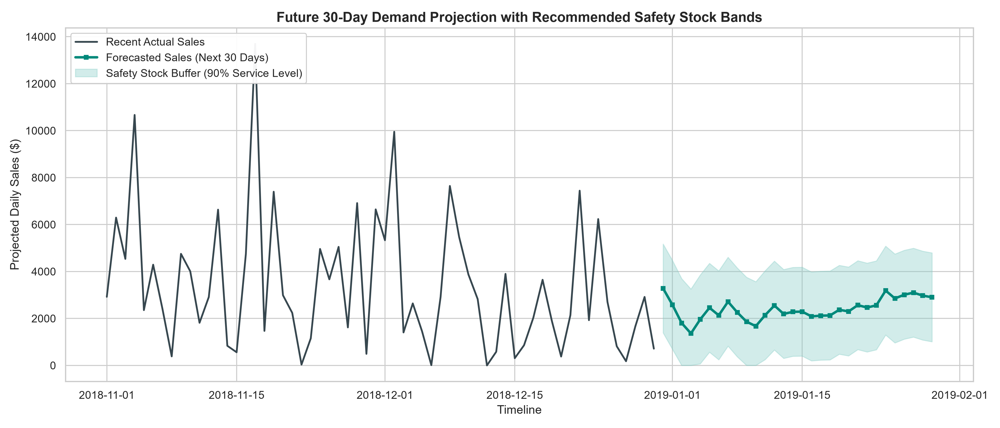

# 📈 Sales & Demand Forecasting for Businesses

[](https://www.python.org/)
[](https://opensource.org/licenses/MIT)
[](https://scikit-learn.org/)
[](https://xgboost.ai/)
[](https://futureinterns.com/)

An end-to-end Machine Learning demand forecasting system engineered for real retail and commercial operations. Built with historical sales transaction data, this project delivers predictive insights to support inventory stocking, workforce scheduling, and cash-flow management.

---

## 🌟 Executive Summary & Business Objective

In retail, inaccurate sales forecasts directly cause:
- **Overstocking:** High storage costs, inventory depreciation, and dead stock.
- **Stockouts:** Lost revenue, cancelled orders, and churned customers.
- **Staffing Mismatches:** Excess labor costs during low periods, customer bottlenecks during surges.

This project delivers an **operationalized demand forecasting pipeline** designed to provide non-technical store managers, founders, and supply chain leads with:
1. **Accurate daily demand predictions** across holdout test periods.
2. **Dynamic safety stock intervals (90% service level)** to protect against sudden demand surges.
3. **Actionable operational recommendations** for procurement, staffing, and revenue planning.

---

## 🏗️ Repository Architecture

```text
FUTURE_ML_01/
├── data/
│   ├── raw/
│   │   └── superstore.csv                  # Raw transaction dataset
│   └── processed/
│       ├── cleaned_transactions.csv        # Cleaned transactional records
│       ├── daily_sales.csv                 # Resampled contiguous daily timeline
│       └── features_sales.csv              # 36-column time-series feature matrix
├── notebooks/
│   ├── 01_eda_and_cleaning.ipynb           # Interactive EDA & data munging
│   └── 02_feature_eng_and_modeling.ipynb   # Feature generation, models & forecasting
├── src/
│   ├── __init__.py                         # Package definition
│   ├── data_loader.py                      # Data ingestion & continuous resampling
│   ├── feature_engineering.py              # Temporal features, lags & rolling metrics
│   ├── model.py                            # Candidate models & recursive forecaster
│   └── evaluate.py                         # Retail metrics (MAE, RMSE, wMAPE, R2)
├── reports/
│   ├── figures/                            # High-resolution presentation plots
│   │   ├── 01_sales_trend_over_time.png
│   │   ├── 02_sales_seasonality_monthly.png
│   │   ├── 03_sales_day_of_week.png
│   │   ├── 04_category_performance.png
│   │   ├── 05_actual_vs_predicted_test.png
│   │   ├── 06_model_comparison_metrics.png
│   │   └── 07_future_demand_forecast_with_safety_stock.png
│   ├── business_executive_summary.md       # 1-page executive brief for stakeholders
│   ├── model_comparison_leaderboard.csv    # Performance leaderboard
│   └── future_30d_forecast.csv             # 30-day projected demand with safety bands
├── run_pipeline.py                         # Master CLI orchestrator
├── requirements.txt                        # Python dependencies
├── .gitignore                              # Git exclusion rules
└── README.md                               # Project documentation
```

---

## 📊 Dataset & Exploratory Analysis (EDA)

The pipeline utilizes the **Superstore Sales Dataset**, featuring comprehensive transactional data across products, regions, categories, and customer segments.

### Key EDA Insights:
1. **Seasonality:** Pronounced surges occur in **Q4 (September through December)**, driven by back-to-school and holiday commercial activity.
2. **Weekly Cycles:** Peak sales volume consistently concentrates on **Tuesdays, Fridays, and Saturdays**, while mid-week exhibits lower transaction density.
3. **Category Concentration:** **Technology** generates the largest average transaction value, followed by **Furniture** and **Office Supplies**.

| Historical Trend & Moving Average | Monthly Seasonality Breakdown |
| :---: | :---: |
|  |  |

| Weekly Order Value Cycle | Category Revenue Performance |
| :---: | :---: |
|  |  |

---

## ⚙️ Time-Series Feature Engineering

To enable regression and tree-based models to learn temporal dynamics without data leakage:

1. **Continuous Resampling:** Raw transactions are aggregated to continuous daily frequency ($f=\text{Day}$), imputing non-trading days with 0 sales.
2. **Calendar & Cyclical Encoding:**
   - Calendar flags: `day_of_week`, `day_of_month`, `month`, `quarter`, `year`, `is_weekend`, `is_month_end`.
   - Cyclical trigonometric features: $\sin / \cos$ mappings for months and days to model smooth calendar transitions.
3. **Autoregressive Lags ($t-1$ Shifted):**
   - Lags at $t-1, t-7, t-14, t-21, t-28, t-30$.
   - Captures weekly seasonality (e.g., $t-7$ compares Monday to last Monday).
4. **Rolling Window Aggregations:**
   - 7, 14, and 30-day rolling means, standard deviations, minimums, and maximums.
   - 7-day and 30-day Exponential Moving Averages (EMA).
   - **Zero-Leakage Guarantee:** All rolling features are strictly applied to shifted series `df['total_sales'].shift(1)`.

---

## 🧪 Out-of-Time Model Evaluation

> **Why Chronological Split?**  
> Random `train_test_split(shuffle=True)` is invalid for time-series as it leaks future information into past predictions. We reserve the **final 90 days** as a strict out-of-time holdout test set.

### Retail Evaluation Metrics:
- **MAE (Mean Absolute Error):** Average dollar discrepancy per day.
- **RMSE (Root Mean Squared Error):** Penalizes extreme demand spikes and potential stockouts.
- **wMAPE (Weighted Mean Absolute Percentage Error):** The retail industry standard (Amazon/Walmart) metric defined as:
  $$\text{wMAPE} = \frac{\sum |y_i - \hat{y}_i|}{\sum y_i} \times 100\%$$
  Avoids division-by-zero distortions common in traditional MAPE on low-sales days.

### Leaderboard Results:

| Model | MAE ($) | RMSE ($) | wMAPE (%) | R² Score | Status |
| :--- | :---: | :---: | :---: | :---: | :---: |
| **Random Forest Regressor** | **$2,064.64** | **$2,866.45** | **67.06%** | **0.0895** | 🏆 **Winner** |
| XGBoost Regressor | $2,126.49 | $2,892.55 | 69.07% | 0.0728 | Evaluated |
| Ridge Regression | $2,141.95 | $3,028.26 | 69.57% | -0.0162 | Evaluated |
| Baseline (Lag-7 Persistence) | $2,807.33 | $4,119.00 | 91.19% | -0.8801 | Baseline |

| Holdout Test: Actual vs Predicted | Metric Leaderboard Comparison |
| :---: | :---: |
|  |  |

---

## 🔮 Future 30-Day Demand Projection & Safety Stock

Using our winning model, the pipeline generates a recursive forward forecast for the next 30 days along with **90% Service Level Safety Stock bands** ($Z = 1.65$):



### Key Projections:
- **30-Day Projected Revenue:** Generated dynamically in `reports/future_30d_forecast.csv`
- **Dynamic Safety Buffer:** Recommended upper stocking threshold protects store operations against unforeseen demand spikes while minimizing excessive holding capital.

---

## 💼 Actionable Business Recommendations

1. **Procurement Lead Time:** Issue warehouse purchase orders 10–14 business days before predicted demand surges to secure volume discounts and prevent carrier delays.
2. **Staffing Allocation:** Schedule additional fulfillment floor associates on high-run days (weekends and Q4 month-ends).
3. **Cash Flow Governance:** Align vendor accounts payable schedules with forecasted daily revenue inflows.

Read the complete business report in [reports/business_executive_summary.md](reports/business_executive_summary.md).

---

## 🚀 Quickstart & Reproduction

### 1. Clone the Repository
```bash
git clone https://github.com/LohithGopi/FUTURE_ML_01.git
cd FUTURE_ML_01
```

### 2. Install Dependencies
```bash
pip install -r requirements.txt
```

### 3. Run the Complete End-to-End Pipeline
```bash
python run_pipeline.py
```
This command automatically executes data cleaning, generates EDA plots, extracts features, trains and benchmarks all models, produces holdout evaluations, and generates the 30-day future demand forecast.

---

## 🏷️ Future Interns Task Submission

- **Task Name:** Machine Learning Task 1 (2026) – Sales & Demand Forecasting for Businesses
- **Organization:** [Future Interns](https://futureinterns.com/)
- **Author:** Lohith Gopi
- **LinkedIn Profile:** [Lohith Gopi](https://www.linkedin.com/in/lohithgopi/)
- **Tagging:** `@Future Interns` `#MachineLearning #DataScience #SalesForecasting #Python #FutureInterns`
